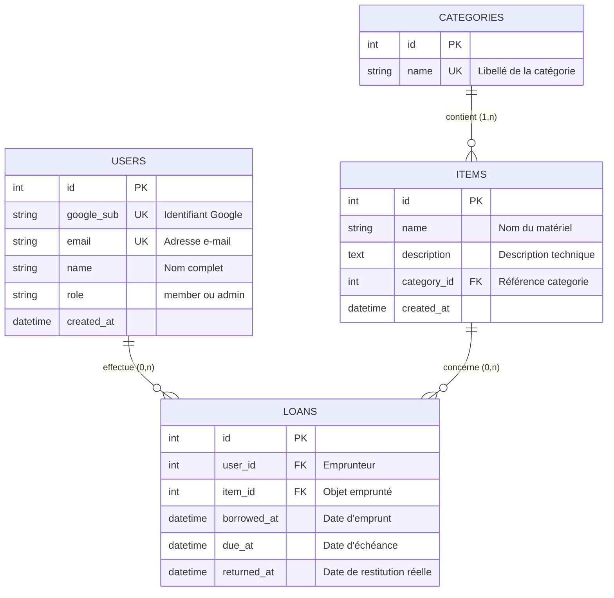

# Modèle Conceptuel et Logique de Données (MCD & MLD) - PretMat

Ce document présente la modélisation des données relationnelles de l'application **PretMat**, conçue manuellement sans ORM pour respecter les exigences du référentiel RNCP37674BC02 (Compétence 5).

---

## 1. Modèle Conceptuel de Données (MCD)

### Entités et Attributs

* **UTILISATEUR** : représente une personne authentifiée via Google OAuth 2.0.
  * `id` : identifiant numérique unique (Clé Primaire)
  * `google_sub` : identifiant stable universel fourni par Google OpenID Connect
  * `email` : adresse de messagerie électronique
  * `nom` : nom complet ou pseudonyme
  * `role` : rôle attribué (`member` ou `admin`)
  * `date_creation` : horodatage de première connexion

* **CATEGORIE** : classification taxonomique du matériel.
  * `id` : identifiant numérique (Clé Primaire)
  * `nom` : libellé de la catégorie (ex : Photo & Vidéo, Son & Audio)

* **MATERIEL** : équipement physique appartenant au club et pouvant être prêté.
  * `id` : identifiant numérique (Clé Primaire)
  * `nom` : nom de l'équipement
  * `description` : détails techniques ou état du matériel
  * `date_creation` : date d'ajout à l'inventaire

* **PRET** (Entité associative / Relation porteuse de propriétés) :
  * `id` : identifiant unique de la transaction de prêt
  * `date_emprunt` : date et heure de départ de l'emprunt
  * `date_retour_prevue` : date d'échéance convenue ($1 \le N \le 14$ jours)
  * `date_restitution` : date effective de restitution (`NULL` tant que le prêt est en cours)

### Associations et Cardinalités

* **Appartenir (MATERIEL $\rightarrow$ CATEGORIE)** :
  * Un MATERIEL appartient obligatoirement à une et une seule CATEGORIE (`1,1`).
  * Une CATEGORIE contient un ou plusieurs MATERIELS (`0,n`).
* **Effectuer (UTILISATEUR $\rightarrow$ PRET)** :
  * Un UTILISATEUR peut effectuer de 0 à $n$ PRETS (`0,n`).
  * Un PRET est effectué par un et un seul UTILISATEUR (`1,1`).
* **Concerner (MATERIEL $\rightarrow$ PRET)** :
  * Un MATERIEL peut faire l'objet de 0 à $n$ PRETS au fil du temps (`0,n`).
  * Un PRET concerne un et un seul MATERIEL (`1,1`).

---

## 2. Diagramme Entité-Association (Mermaid)

---

## 3. Modèle Logique de Données (MLD)

Structure textuelle formelle :

* **users** (<ins>id</ins>, google_sub, email, name, role, created_at)
  * Clé primaire : `id`
  * Clés alternatives (uniques) : `google_sub`, `email`
  * Contrainte de domaine : `role IN ('member', 'admin')`

* **categories** (<ins>id</ins>, name)
  * Clé primaire : `id`
  * Clé alternative (unique) : `name`

* **items** (<ins>id</ins>, name, description, #category_id, created_at)
  * Clé primaire : `id`
  * Clé étrangère : `category_id` en référence à `categories(id)` avec `ON DELETE RESTRICT`

* **loans** (<ins>id</ins>, #user_id, #item_id, borrowed_at, due_at, returned_at)
  * Clé primaire : `id`
  * Clé étrangère : `user_id` en référence à `users(id)` avec `ON DELETE RESTRICT`
  * Clé étrangère : `item_id` en référence à `items(id)` avec `ON DELETE RESTRICT`
  * Contrainte de validation : `due_at > borrowed_at`
  * Index de performance : `(item_id, returned_at)` et `(user_id, returned_at)`

---

## 4. Règles d'intégrité et contraintes relationnelles

1. **Intégrité de référence et suppression d'objets** :
   * La contrainte `FK loans.item_id ON DELETE RESTRICT` empêche toute suppression physique d'un matériel ayant au moins un prêt enregistré dans l'historique.
   * L'application valide également en amont l'absence de prêt actif pour afficher un message utilisateur clair et contextualisé.
2. **Intégrité des catégories** :
   * La contrainte `FK items.category_id ON DELETE RESTRICT` interdit la suppression d'une catégorie tant qu'elle contient des équipements.
3. **Unicité des comptes** :
   * `google_sub` est unique : garantit qu'un compte Google correspond strictement à un seul enregistrement utilisateur.
   * `email` est unique : évite les conflits d'adresses.
4. **Cohérence temporelle des prêts** :
   * La contrainte `CHECK (due_at > borrowed_at)` garantit au niveau du moteur de stockage que l'échéance est postérieure à la date d'emprunt.
